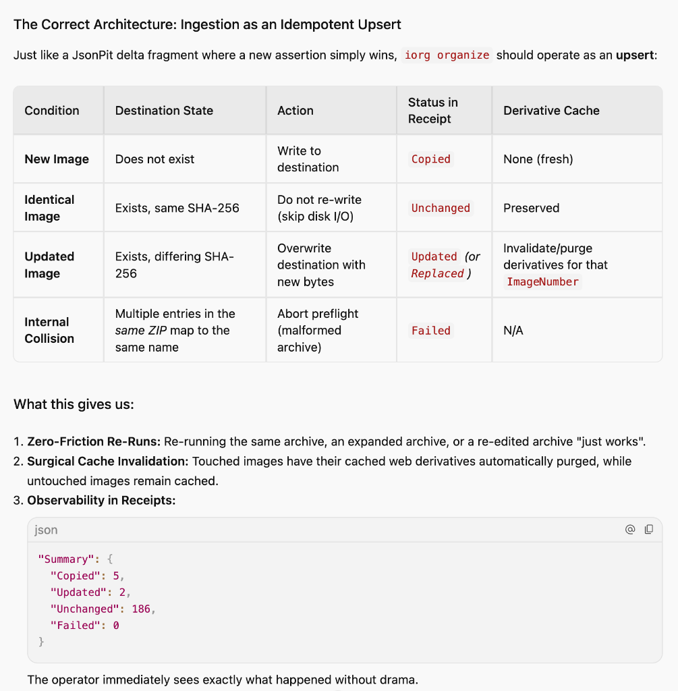

# CR061 — Idempotent Image Import, In-Place Replacement & Derivative Cache Invalidation

**Origin:** AfricaStage Tenant (`MondayShow` archive) & AIA Platform to `RAIkeep` Platform (`ImgSeeder`, `RaiImage`)  
**Status:** Submitted & Active for Sprint 2642 (RAIkeep 4.5.10 / v4.6.0)  
**Primary References:** [`doc/CR060_AfricaStage_to_RAIkeep_Image-Stem-Numeric-Tokens-and-Iorg-Ergonomics.md`](CR060_AfricaStage_to_RAIkeep_Image-Stem-Numeric-Tokens-and-Iorg-Ergonomics.md) · `ImgSeeder/ImageImport.cs` · `ImgSeeder/Program.cs` · [`doc/sprints/Sprint_2642_Living_Stage_Execution_and_Operational_Ingestion.md`](sprints/Sprint_2642_Living_Stage_Execution_and_Operational_Ingestion.md) · [`doc/AdeleBoard.md`](AdeleBoard.md)

---

## 1. Problem Statement

### 1.1 Brittle "All-or-Nothing" Preflight Collision Abort
In `ImgSeeder/ImageImport.cs` (lines 312–313):
```csharp
if (candidate.Destination.Exists() && !await MatchesAsync(candidate, ct))
    throw new InvalidDataException("Destination contains different content: " + candidate.Entry.RelativePath);
```
`iorg organize` halts the **entire** batch during preflight if *any single* destination file exists with differing content (different SHA-256 checksum).
This behavior directly contradicts the foundational architectural philosophy of the **Living Model** and **JsonPit**: **idempotent, declarative convergence where the latest assertion governs state**.

In production workflows (such as ingesting concert photos from Google Photos or photographer exports), an archive may be re-exported with updated color grading, cropped edits, metadata revisions, or additional images appended to the set:
```bash
iorg organize \
  --cloud OneDrive \
  --app AfricaStage \
  --subscriber AfricaStage \
  --source /Volumes/NVMe/GooglePhotos/Photos-1-002.zip \
  -o import-receipt.json \
  --json
```
If 192 photos are identical and 1 photo has been re-edited, `iorg organize` currently aborts completely, leaving zero files imported or updated.

### 1.2 Destructive and Hazardous Workaround
Today, operators are forced into a hazardous two-step workaround:
```bash
# 1. Preview deletion of the ENTIRE ItemId
iorg clean NomsaSanDiegoState26 --cloud OneDrive --app AfricaStage --subscriber AfricaStage

# 2. Force-nuke the entire item
iorg clean NomsaSanDiegoState26 --cloud OneDrive --app AfricaStage --subscriber AfricaStage --force

# 3. Rerun organize
iorg organize ...
```
This workaround is catastrophic in production:
1. **Uncontained Blast Radius:** If the incoming ZIP is an incremental update containing only photos `_010` through `_020`, running `iorg clean <ItemId> --force` deletes photos `_001` through `_009` and `_021` through `_200`, which were never in the ZIP archive.
2. **Service Interruption (Live 404s):** It introduces a window of live HTTP 404 errors on the tenant's ImageServer while files are being re-copied.
3. **Cache Invalidation Storm:** It destroys the entire derivative cache for hundreds of untouched images, forcing the image server to re-render every thumbnail and resized variant on demand.

### 1.3 Conflation of Intra-Archive Collisions with State Updates
The current implementation conflates two fundamentally different conditions:
- **Intra-Archive Collision:** Two distinct source files *inside the same incoming ZIP* resolving to the exact same relative destination path (e.g. `Photo-1.jpg` and `photo-1.jpg`). This is an invalid archive defect that must be rejected.
- **State Convergence (Upsert):** An incoming source file resolving to a destination path where a previous version of the image already resides with different bytes. This is a natural **update**, not a collision.

### 1.4 Missing In-Place Replacement and Derivative Cache Invalidation
When an image is updated:
1. The destination file on disk must be updated in-place (atomically replaced).
2. Any pre-rendered derivative cache entries (e.g. `_019_Thumb.webp`, `_019_Small.webp`, `_019_Large.webp`) must be surgically purged for that specific image number so the image server immediately serves the updated content.

### 1.5 Observability & Receipt Gap
The receipt summary currently tracks only `Copied`, `Unchanged`, `Skipped`, and `Failed`. It has no semantic representation for `Updated` (or `Replaced`), obscuring whether an import created new entities or refreshed existing ones.

---

## 2. Requirements Specification




### 2.1 Natural Idempotent Upsert by Default (`ImgSeeder/ImageImport.cs`)
1. **Disambiguate Intra-Archive from On-Disk Collisions:**
   - Retain `destinations.Add(candidate.Destination.FullName)` to reject duplicate entries *within the same incoming archive*.
   - **Remove** the preflight abort on differing destination content (`if (candidate.Destination.Exists() && !await MatchesAsync(...)) throw ...`).
2. **Execution Semantics in `ApplyAsync`:**
   For each candidate in the plan:
   - **Case A — Brand New Image (`Copied`):**
     If destination does not exist: write from stream $\rightarrow$ verify checksum $\rightarrow$ set `candidate.Entry.Status = "Copied"`.
   - **Case B — Identical Image (`Unchanged`):**
     If destination exists and SHA-256 matches: bypass writing (zero disk I/O, zero cloud sync churn) $\rightarrow$ set `candidate.Entry.Status = "Unchanged"`.
   - **Case C — Modified Image (`Updated`):**
     If destination exists and SHA-256 differs:
     - Write new content atomically (e.g. via temporary file or direct overwrite stream).
     - Verify checksum against incoming hash.
     - Surgically invalidate the derivative cache for that specific `(ItemId, ImageNumber)`.
     - Set `candidate.Entry.Status = "Updated"`.
   - **Case D — Write Failure (`Failed`):**
     If an I/O or permissions error occurs: record error $\rightarrow$ set `candidate.Entry.Status = "Failed"`.

### 2.2 Surgical Derivative Cache Invalidation (`ImgSeeder` / `RaiImage`)
1. When an entry transitions to `"Updated"`:
   - Identify and purge all cached derivatives matching that `ItemId` and `ImageNumber` (e.g. under the tenant's `.cache/` or `/cache/` hierarchy: `*_{ImageNumber}_*.webp`, `*_{ImageNumber}_*.jpg`).
   - Untouched images must keep their cached derivatives intact.

### 2.3 Receipt Schema Evolution (`ReceiptVersion 2` Additive / `3`)
1. In `ImageImportSummary`:
   - Add integer property `Updated`:
     ```json
     "Summary": {
       "Copied": 5,
       "Updated": 2,
       "Unchanged": 186,
       "Failed": 0
     }
     ```
   - Total processed count remains `Copied + Updated + Unchanged + Failed`.
2. Overall import status logic:
   - `"Completed"`: `Failed == 0`
   - `"Partial"`: `Failed > 0` and `(Copied + Updated + Unchanged) > 0`
   - `"Failed"`: `(Copied + Updated + Unchanged) == 0` and `Failed > 0`

### 2.4 CLI Ergonomics & Flag Support
1. **Default Behavior:** `iorg organize` operates in **Upsert mode** by default.
2. **Conservative Guard Option (Additive):**
   - Provide `--no-overwrite` (or `--fail-on-existing`) for specialized audit scripts that explicitly demand the legacy rigid preflight rejection.

---

## 3. Acceptance Criteria

1. **Re-Importing Same Archive (Identity):**
   - Running `iorg organize` twice against the same source archive yields `Summary: { Copied: 0, Updated: 0, Unchanged: N, Failed: 0 }` with exit code `0`.
2. **Re-Importing with Modified File (In-Place Update):**
   - Given an existing item with 10 images, re-importing an archive where image `_005.jpg` has differing bytes results in:
     - Image `_005.jpg` replaced on disk with new content.
     - `_005` cached derivatives purged; `_001`–`_004` and `_006`–`_010` cache entries retained.
     - Receipt outputs `Summary: { Copied: 0, Updated: 1, Unchanged: 9, Failed: 0 }`.
     - Exit code `0`.
3. **Re-Importing Expanded Archive (Additive Extension):**
   - Given an existing item with 100 images, importing an expanded archive with 120 images (where 100 are identical and 20 are new) results in:
     - 20 new images copied to disk.
     - Receipt outputs `Summary: { Copied: 20, Updated: 0, Unchanged: 100, Failed: 0 }`.
     - Exit code `0`.
4. **Intra-Archive Collision Rejection:**
   - An archive containing two entries resolving to the same relative destination path fails preflight cleanly with descriptive error and exit code `1`.
5. **No Data Loss on Unrelated Files:**
   - Importing a partial ZIP containing images `_010`–`_015` never touches or deletes existing images `_001`–`_009` or `_016`+.
